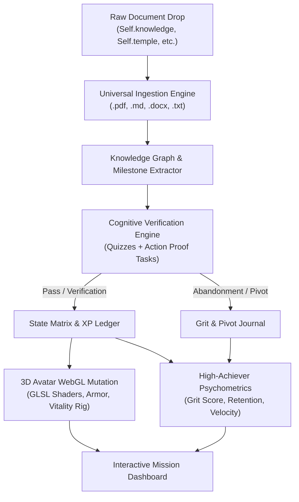

# SELF. // Closed-Loop Personal Evolution OS

```
/*
 *  =======================================================
 *                 SELF. // LIFE RPG OS
 *   "Ingest -> Verify -> Evolve -> Chronicle -> Measure"
 *  =======================================================
 */
```

`Self.` is a sovereign personal evolution operating system. It transforms offline knowledge guides, protocols, and life documents (`.md`, `.docx`, `.pdf`, `.txt`) into verified physical and cognitive competence—reflected live through the metamorphosis of a 3D humanoid avatar.

---

## 🌟 Core Loop



---

## 🏛 Domain & Avatar Binding Matrix

Each life domain in `src/` governs a distinct anatomical, visual, and behavioral layer of the 3D Avatar:

| Domain | Ingestion Focus | Avatar Visual Layer | Tier 1 (Novice) | Tier 5 (Sovereign) |
| :--- | :--- | :--- | :--- | :--- |
| **`Self.knowledge`** | Survival guides, mental models, cognitive science, philosophy | **Neural HUD, Glyphs & Orbital Crown** | Faint spark | Golden orbiting glyphs, holographic halo |
| **`Self.career`** | Patents, business docs, code repos, execution blueprints | **Exoskeleton Armor & Kinetic Plates** | Civilian mesh | Hardened cybernetic composite armor |
| **`Self.credit`** | Financial statements, consumer credit law, wealth vehicles | **Radiance, Aura & Fresnel Shader** | Matte grey | Iridescent auric bloom, gold fresnel glow |
| **`Self.temple`** | Physical training, biohacking protocols, nutrition, recovery | **Base Mesh Anatomy & Posture Machine** | Fatigued / slouched posture | Aligned combat poise & sovereign levitation |
| **`Self.legal`** | Identity records, background reports, entity compliance | **Structural Rigidity & Runes** | Unanchored | Immovable foundation, protective runic seal |

---

## ⚡ Quick Start

### 1. Prerequisites
- **Python 3.10+** (with `pymupdf`, `fastapi`, `uvicorn`, `python-dotenv`)
- **Node.js 18+** (with `three`, `@react-three/fiber`, `@react-three/drei`, `dotenv`)

### 2. Environment Configuration
```bash
# Copy example configuration template
cp .env.example .env

# Edit .env with your local settings (strictly gitignored)
```

### 3. Ingest Knowledge & Life Documents
Drop your documents (`.md`, `.docx`, `.pdf`, `.txt`) into their respective `src/Self.<domain>` folders, then sync:
```bash
python src/engine/universal_ingestor.py
```

### 4. Manage Tasks & Quests (CLI)
```bash
# Add a new mission
python src/engine/task_manager.py add "Review Toxic Plant Red Flags in Botanical Guide" Self.knowledge 50

# View your tasks
python src/engine/task_manager.py list

# Complete a mission (awards XP, advances 3D Avatar, and writes to journal)
python src/engine/task_manager.py complete <task_id>

# View statistics
python src/engine/task_manager.py stats
```

### 5. Launch Mission & Task Dashboard
```bash
python src/engine/server.py
```
Open [http://127.0.0.1:8000](http://127.0.0.1:8000) to access the interactive web control console.

---

## 🔒 Security & Privacy Architecture

- **Zero Cloud Leakage**: Local-first architecture. All documents, state matrices, and journal logs remain strictly on your local machine.
- **Enforced Defense**: `.env`, `.env.*`, and sensitive domains (`src/Self.career/`, `src/Self.credit/`, `src/Self.legal/`) are strictly gitignored to guarantee zero exposure of personal identification, financial statements, or private IP.

---

## 📜 License
MIT License. Built for sovereign individual evolution.
