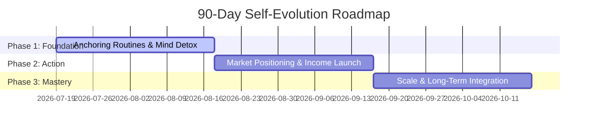

# 🚀 The Arkitech's 90-Day Self-Evolution Plan

Welcome to your **90-Day Self-Evolution Phase**. Starting this Sunday, you are initiating a systematic rewrite of your financial, routine, and mental operating systems. This plan is designed by your EVL Master Coach to turn goals into high-fidelity routines.

---

## 📅 Roadmap Overview

---

## 🛠 Pillar 1: Financial Acceleration (Money & Work)
Your primary objective is to obtain high-paying work and establish robust revenue pipelines.

### Weekly Strategies:
* **Market Audit (Sunday):** Research the high-demand skill areas (e.g., Unity/C#, Unreal/C++, Cocos/TS, AI integrations) and list 5 target opportunities or freelance clients.
* **Cold Outreach / Applications (Mon-Wed):** Dedicate a 2-hour daily block for cold outreach, portfolio submissions, or application scaling.
* **Skill Demonstration (Thu-Fri):** Build open-source micro-projects (e.g., custom shaders, game mechanics templates) and share them on Github/LinkedIn to build public proof of work.

---

## ⚡ Pillar 2: High-Performance Routines
Routines protect your energy. We are establishing non-negotiable routine anchors.

### 🌅 The Morning Ritual (First 90 Minutes)
* **Waking Up (5:30 AM - 6:00 AM):** Immediately hydrate (500ml water) and avoid opening social media or email.
* **Mind Activation (15 mins):** Clean air, light stretching, or cardiovascular activation.
* **Deep Work Block 1 (90 mins):** Dedicate this block entirely to your highest-value financial task (job hunting, pitching, building core products) when your focus is absolute.

### 🌌 The Evening Ritual (Wind-Down)
* **Digital Sunset (9:30 PM):** Put away all screens. Use warm, yellow lighting.
* **Preparation (15 mins):** Write down your top 3 objectives for the next day.
* **Mind Decompression (15 mins):** Read a book or practice slow breathing.
* **Sleep (10:00 PM):** Aim for 7.5 - 8 hours of sleep in a cool, dark room.

---

## 🧠 Pillar 3: Mental Reprogramming (Identity Paradigm)
Reprogramming your mind requires consistent cognitive inputs.

* **Identity Anchoring (Morning):** Read out loud your core vision statements (who you are becoming, your financial goals, and your capabilities).
* **Limiting Belief Audits (Weekly):** Every Friday, write down any negative thoughts or doubts you had during the week (e.g., "I'm not qualified enough") and reframe them into objective, empowering statements.
* **Mindfulness / Subconscious Priming:** Use visualization (5 minutes daily) visualizing your bank account statement reaching your goals and your daily routines working flawlessly.

---

## 📈 Phase Timeline (Days 1 - 90)

### 🗓 Phase 1: Days 1-30 — The Foundation & Routine Anchors
* **Goal:** Eliminate distractions, cement the sleep/wake times, and launch the outreach campaign.
* **Focus:** Build your portfolio site, polish your resume/profile, and establish the morning deep work blocks.

### 🗓 Phase 2: Days 31-60 — Action Blocks & Revenue Launch
* **Goal:** Secure active work, double the output of outreach, and start monetizing.
* **Focus:** Freelance pitching, interview preparation, contract negotiations, and project deliveries.

### 🗓 Phase 3: Days 61-90 — Scale, Optimization, & Integration
* **Goal:** Lock in recurring income streams, optimize daily energy reserves, and turn routines into lifelong defaults.
* **Focus:** Rate increases, process automation, long-term health checkups, and establishing the next 12-month vision.

---

## 📊 Daily Accountability Tracker

Every evening, evaluate your day on a scale of 0 to 1 for the following anchors:
1. **Wake time met?** (0 / 1)
2. **Deep Work Block 1 completed?** (0 / 1)
3. **Daily outreach block completed?** (0 / 1)
4. **Digital Sunset met?** (0 / 1)

*Your evolution starts this Sunday. No excuses. Evolve or repeat.*
